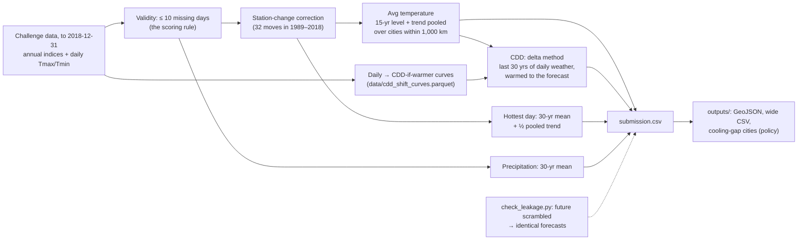

# Carbon Copies: Protostar Climate Challenge Submission

**Negative result:** no

: a GitHub Actions job rebuilds every result from this repository on a clean machine and fails if `submission.csv` or any output changes.

Forecasts of yearly weather for 210 U.S. cities, 2019–2025, made as of the end of 2018 (no data that reveals 2019–2025 weather), for the [Protostar Challenge: Climate Risk Intelligence](https://huggingface.co/spaces/CMU-OSPO/protostar-challenge-climate-risk-intelligence).

**In one line:** the city's recent level plus a warming trend pooled across neighboring cities. Cooling degree days come from replaying each city's last 30 years of *daily* weather, warmed to that forecast. In backtests it beats the 30-year average by 11–17% on temperature and 8–17% on CDD. On precipitation, honestly, nothing we tried beat the 30-year average. A look-ahead test (`code/check_leakage.py`) proves the model uses no data after its forecast date.

## Team

| Name | Hugging Face username | University, Program |
|---|---|---|
| Naina Dhingra | [@ndhingraa](https://huggingface.co/ndhingraa) | Carnegie Mellon University |
| Mitra Barve | [@mitrab](https://huggingface.co/mitrab) | Carnegie Mellon University |
| Janeshvar Sivakumar | [@jaane123](https://huggingface.co/jaane123) | Carnegie Mellon University |
| Anav Singh | [@anavsingh99](https://huggingface.co/anavsingh99) | Carnegie Mellon University |
| Tanishqa Porwal | [@tanishqa126](https://huggingface.co/tanishqa126) | Carnegie Mellon University |

## Method

**Model (per metric, `code/forecast.py`):**

| Metric | Forecast |
|---|---|
| `annual_avg_temp` | Mean of the last 15 years + regional trend × years since the middle of that window |
| `cdd` | **Delta method:** take every day of the city's last 30 valid years and warm it by (temperature forecast − mean temperature of those years). Recompute each year's CDD and average |
| `hottest_day_temp` | 30-year mean + half the regional trend |
| `total_precip_in` | 30-year mean (nothing beat it; see below) |

- **Regional trend:** the slope of the 50-year anomaly series averaged over all cities within 1,000 km. One station's 30-year trend is mostly noise. Pooling neighbors keeps the regional warming signal and averages away station quirks.
- **Station changes:** 32 station moves fall in 1989–2018. Years recorded at an earlier station are shifted to the current station's level. The step is estimated from 10 years each side of the move, net of the national anomaly, so warming is not mistaken for a station jump.
- **Validity:** we drop years with more than 10 missing days, the same rule the challenge scores with.
- **Why the delta method for CDD:** CDD only counts warmth above 65 °F. A city with many days just under 65 °F gains a lot of CDD per degree of warming, while a city that is rarely warm gains little. A yearly trend line cannot see that; the daily record can. `code/prepare_data.py` condenses the 10-million-row daily table into a 2 MB table: each city-year's CDD if every day were s °F warmer, s = −3 … +6 in 0.25 °F steps. At s = 0 it matches the official `cdd` column exactly.
- **Learned models (`code/learned.py`, tested, not in the final model):** ridge and gradient boosting, trained across cities on past forecast origins. The target is the standardized departure from the 30-year mean. Features are recent anomalies of the city, its region and the nation, plus trends × lead time. Training uses only origins whose targets were fully observed (origin + 7 ≤ forecast origin).

**How we checked it:** a rolling-origin backtest on data up to 2018 only. From each origin year we forecast the next 7 years with only earlier data and score with the challenge formula, 100 × mean of (1 − MAE / MAE of the 30-year average). We chose settings on origins **1997–2004** ("tune") and confirmed them on **2005–2011** ("check"). We never looked at 2019–2025 observations, and we did not use the live leaderboard to choose between models. `code/check_leakage.py` reruns the model from 1998, 2004 and 2011 with every later value replaced by random noise and requires identical forecasts. It also confirms that a deliberately leaky model is caught.

**Final model, backtest** (`code/backtest_results.csv`). Each metric's number is the improvement over the 30-year average; 0 = no better.

| Split | Score | Avg temp | Precip | Hottest day | CDD | MAE: temp °F / precip in / hottest °F / CDD °F-days |
|---|---|---|---|---|---|---|
| tune (1997–2004 origins) | 6.14 | +0.166 | 0.000 | +0.003 | +0.077 | 0.95 / 5.72 / 2.58 / 152 |
| check (2005–2011 origins) | 7.24 | +0.114 | 0.000 | +0.008 | +0.169 | 1.32 / 6.00 / 2.68 / 165 |

**What we tried** (`python code/backtest.py compare` → `code/experiments.csv`; same backtest):

| Model | Score tune / check | Avg temp | Precip | Hottest day | CDD |
|---|---|---|---|---|---|
| baseline: last year (score floored at 0) | 0.00 / 0.00 | -0.592 / -0.465 | -0.297 / -0.323 | -0.427 / -0.433 | -0.527 / -0.478 |
| baseline: city linear trend 30y | 1.17 / 2.00 | +0.135 / +0.070 | -0.060 / -0.061 | -0.091 / -0.061 | +0.012 / +0.107 |
| mean of last 10 years | 2.59 / 3.46 | +0.128 / +0.069 | -0.024 / -0.012 | -0.029 / -0.017 | +0.029 / +0.099 |
| mean of last 15 years | 4.12 / 2.94 | +0.143 / +0.069 | -0.005 / -0.005 | -0.017 / -0.002 | +0.043 / +0.056 |
| level15 + pooled trend (one setting) | 4.50 / 6.04 | +0.166 / +0.114 | -0.022 / -0.001 | -0.014 / +0.006 | +0.049 / +0.123 |
| level+trend, per-metric PARAMS | 5.45 / 6.12 | +0.166 / +0.114 | +0.000 / +0.000 | +0.003 / +0.008 | +0.049 / +0.123 |
| ridge, all origins since 1940 | 4.71 / 0.61 | +0.182 / -0.008 | -0.021 / -0.017 | -0.019 / -0.032 | +0.047 / +0.007 |
| ridge, last 30 origins | 4.24 / 2.24 | +0.208 / +0.051 | -0.033 / -0.021 | -0.039 / -0.013 | +0.034 / +0.073 |
| GBM, all origins since 1940 | 4.72 / 2.90 | +0.150 / +0.044 | -0.007 / -0.030 | -0.017 / -0.003 | +0.063 / +0.106 |
| GBM, last 30 origins | 5.75 / 3.98 | +0.199 / +0.084 | -0.008 / -0.039 | -0.025 / -0.021 | +0.065 / +0.135 |
| temp: trend fitted since 1975 | – (temp only) | +0.166 / +0.111 | – | – | – |
| temp: trend x1.5 (amplified) | – (temp only) | +0.103 / +0.102 | – | – | – |
| temp: Tmax and Tmin forecast separately | – (temp only) | +0.166 / +0.114 | – | – | – |
| CDD from temperature forecast | – (CDD only) | – | – | – | +0.059 / +0.139 |
| CDD: from temperature + GBM (previous final) | – (CDD only) | – | – | – | +0.070 / +0.143 |
| CDD: delta method, 15 years | – (CDD only) | – | – | – | +0.063 / +0.153 |
| CDD: delta method, 30 years | – (CDD only) | – | – | – | +0.077 / +0.169 |
| bias correction from own past errors (temp, CDD; 15 yrs, ×0.5) | 6.38 / 7.13 | +0.180 / +0.112 | +0.000 / +0.000 | +0.003 / +0.008 | +0.073 / +0.166 |
| **FINAL (`forecast.py`)** | **6.14 / 7.24** | +0.166 / +0.114 | +0.000 / +0.000 | +0.003 / +0.008 | +0.077 / +0.169 |

**What we learned:**
- **Warming is the signal; everything else is noise.** All of the gain is in temperature and CDD. Precipitation and the hottest day vary so much from year to year that every attempt to follow recent years or trends did worse than the 30-year mean. We kept the 30-year mean there on purpose.
- **Pool trends, don't fit them per station.** A per-city linear trend (a challenge baseline) is unstable. A trend pooled within 1,000 km is steadier and better in both splits.
- **Learned models trained on the whole record fail on recent decades.** Trained on origins since 1940, ridge and gradient boosting learned the mid-century cooling and post-1980 warming as one relationship. They score about 4.7 in the tune split but only 0.6–2.9 in the check split. Restricting training to the last 30 origins helps: gradient boosting then has the best temperature number in the tune split. Alone, though, they still lose to the simple model in the check split, which is closer to the regime we forecast. A gradient-boosting + CDD-from-temperature blend was our previous final model; the delta method beat it in both splits with no learned parameters.
- **CDD is better forecast through temperature than on its own.** CDD is a nonlinear function of temperature, and the temperature trend is estimated far more reliably. A per-city CDD-per-°F slope helped. Replaying the daily weather (delta method) helped more, and 30 years of days beat 15, because more summers sample the tail of hot days better.
- **Making the trend steeper did not help.** Fitting the trend only since 1975 tied our 50-year window, and forecasting Tmax and Tmin separately gave identical results. Multiplying the trend by 1.5 lowered the backtest score in both splits, so we did not do it, even though 2019–2021 were warm years.
- **Caveat:** we chose the 50-year trend window and the 30-year delta window partly by the check split, so the check score is slightly optimistic. The tune score is the cleaner estimate.

### Live score check (after submitting, analysis only)

Our first submission (Nov 7) scored **12.9** on the live board (2019–2021). By metric, 1 − MAE / MAE of the 30-year average: temperature +0.263 (MAE 1.089 °F), CDD +0.258 (146.9 °F-days), hottest day −0.004, precipitation 0. The top teams score about 16, almost entirely through lower temperature and CDD errors: **our forecast ran cool** in three warm years.

The rules forbid choosing a model by its 2019–2025 score, so we did not steepen the trend to match. Instead, we asked whether the same bias shows up **before 2018** (`python code/backtest.py bias` → `code/bias_by_origin.csv`):

- Our temperature forecast was **too cold at 25 of 27 backtest origins (1985–2011), by −0.34 °F on average**. CDD ran low by 22 °F-days. A recent level plus a trend lags a climate that keeps warming.
- We then tested a fix: a correction learned from the model's own past errors (`climate_lib.bias_corrected`, leak-tested). It improved the tune split but lowered the held-out split (table above). Stronger versions hurt both. Earlier, amplifying the trend ×1.5 also failed.
- **Conclusion:** the cold bias is real on average, but it cannot be predicted from recent errors. It moves with year-to-year national anomalies more than with a steady drift. With no change that passes our pre-2018 test, **we kept the model**. We report the bias here because planners using trend-based "normals" should expect them to run cool.

We made this check after seeing the live score; the decision was made only on pre-2018 backtests.

## AI Tools and Agents

- **Tools and models:** Claude Code (Claude Opus 5.5), an AI coding agent, in VS Code.
- **What they did:** read the challenge pages, the template and other teams' public READMEs (for ideas; the delta method for CDD was used by other teams first, and we adopted it only after it won our own backtest). Downloaded the training data (2018 cutoff enforced in code), wrote the code in `code/`, ran the backtests, the experiment comparison and the leakage test, and drafted this README and the data card.
- **What a person reviewed:** _To be completed by the team before the deadline._
- **Agent instructions file:** `code/AGENTS.md` (template rules plus our team notes). Guardrails: `load_panel()` stops if any input is dated after 2018. Every forecast value comes from `code/forecast.py`; the agent wrote no value itself.

## Policy Idea

**Cooling readiness for "newly hot" cities.**

1. **What risk did we notice?** Cooling demand rises almost everywhere: CDD goes up in 209 of 210 cities, by a median of 10%, in our 2019–2025 forecast versus 1989–2018. The biggest *relative* jumps are not in the South. They are in the 101 cities that historically needed little cooling (under 1,000 °F-days), where the median rise is **13.5%, against 8.6%** elsewhere. The steepest: **Sault Ste. Marie +33%, Elko +28%, San Diego +26%, Duluth +25%, Bluefield +23%, Helena +22%, Vancouver WA +21%, Rochester MN +21%, Colorado Springs +21%, Lansing +21%, Reno +20%**, with Seattle (+20%), Burlington VT and Worcester (+19%) close behind (`outputs/cdd_change_by_city.csv`). Phoenix adds more °F-days, but it already has the air conditioning, building codes and heat plans to handle them. In mild-climate cities, many homes, schools and care facilities have no cooling, and residents and health systems have little heat experience. The same rise in heat does more harm there.
2. **What would we do about it, and who would do it?** A **"cooling-gap" trigger**. Each year, a state climate office or university (e.g., a state climatologist) reruns this open pipeline on the newest records and flags cities whose cooling demand is rising fast from a low base. Flagged cities' health departments and electric utilities then (a) add cooling (heat pumps, which also replace inefficient heating) to existing low-income weatherization and efficiency programs, prioritizing renters, older adults and people living alone; (b) require that new and renovated multifamily housing and schools can be cooled; and (c) adopt a heat-response plan with cooling centers and outreach before the first bad summer, not after.
3. **Why is it sustainable?** It uses money and institutions that already exist (utility efficiency programs, weatherization assistance, building-code cycles) instead of a new agency. Heat pumps pay back through lower heating bills, so they make sense even in years without a heat wave. The trigger costs almost nothing to run: the code, data and model are open, run in about a minute, and update as each year's records arrive.

## Feedback to the Ecosystem

- **What got in the way:**
  - **Validity rules lived in prose, not data.** The "≤ 10 missing days" rule, and CDD's extra "days with both temperatures" condition, had to be rebuilt from the dataset card. Our count of unscorable city-metrics (10) differs from the challenge's (9), so one borderline rule is ambiguous.
  - **Station changes are flagged but not adjusted.** `coverage_and_stations` marks the 32 changes in 1989–2018, but there is no homogenized series, so every team must invent its own adjustment.
  - **No uncertainty in the scoring.** Point forecasts only. For noisy metrics like precipitation, the most useful output for planners is a range, and MAE rewards forecasting the median.
  - **Inconsistent edge values.** The extreme columns use ±inf for years with no data, while other columns use NaN.
  - **The honor code can't be enforced at the source.** The training set stops at 2018, but the public KiltHub records it comes from have since been updated in place and now run to 2023. Anyone can download the answer years from the cited source, and nothing in the challenge detects it.
  - **Unversioned citations point at the answers.** A KiltHub DOI without a version suffix resolves to the latest version, so a team that cites or downloads "the Lai & Dzombak data" without pinning `.v<N>` gets data that contains 2019–2023.
  - **The method paper is paywalled.** Lai & Dzombak (2019, *J. Climate*), the method behind the dataset, was not openly accessible to us (HTTP 403). Teams can reuse the data but not easily the published method or results it would be compared against.
- **What would fix it:**
  - Publish a boolean `valid_<metric>` column per city-year using the exact scoring rule, so training and scoring cannot drift apart.
  - Add a homogenized variant (e.g., NOAA's pairwise homogenization, or the offsets from Lai & Dzombak's method) alongside the raw threaded record.
  - Score a quantile or interval forecast (e.g., pinball loss) as an optional track.
  - Use NaN consistently, and add a machine-readable schema (units, missing-value conventions) to the dataset card.
  - Publish a frozen, pre-2019 release of both KiltHub records with its own DOI, and cite only versioned DOIs in the challenge pages.
  - Run a look-ahead test on finalists' code, like our `check_leakage.leak_test()`: rerun the model from a past origin with every later value scrambled and require identical forecasts. It certifies the data rule from the code alone, without trusting the README.
  - Link an open preprint or author copy of the method paper from the dataset card.
  - Ship the daily data's derived products. The daily table is 10M rows, and most teams only need per-year summaries such as our CDD-if-warmer curves (2 MB). A small "derived" subset would make the daily record usable for teams without much compute.
  - For reuse: our `climate_lib.py` exposes one forecaster signature, a backtest scorer that reproduces the challenge formula, and `check_leakage.leak_test()`, which certifies any forecaster against look-ahead. Future editions could ship a shared harness like it, so teams compare models on the same backtest and organizers can verify the honor code automatically.

## Files

| File | Content |
|---|---|
| `submission.csv` | Our forecasts: `city_id,year,metric,predicted_value` |
| `code/` | Scripts (see [`code/README.md`](code/README.md)): `forecast.py` (final model), `climate_lib.py` and `learned.py` (reusable library), `backtest.py` (experiments), `check_leakage.py` (look-ahead test), `export.py`, `policy_analysis.py`, `prepare_data.py`, `check_submission.py`. Results: `backtest_results.csv`, `experiments.csv` |
| `data/` | The curated data our code uses; described in its data card, [`data/README.md`](data/README.md) |
| `outputs/forecasts.geojson` | One point per city with all forecasts and the change versus 1989–2018. Opens in QGIS, ArcGIS, geojson.io, kepler.gl |
| `outputs/forecasts_wide.csv` | One row per city and year, a column per metric, with name, latitude and longitude |
| `outputs/cdd_change_by_city.csv` | Forecast change in cooling demand per city (Policy Idea) |
| `outputs/README.md` | **Data dictionary** for `submission.csv` and every output: column, type, unit, missing-value and coordinate conventions |
| `CITATION.cff` | How to cite this work and the Lai & Dzombak source data (GitHub and Zenodo read it directly) |
| `.github/workflows/reproduce.yml` | Continuous reproduction: reruns the pipeline and the leakage test, fails if any result changes |

**Metric codes:** `annual_avg_temp` (°F), `total_precip_in` (inches), `hottest_day_temp` (°F), `cdd` (°F-days).
**City IDs:** the station `ID` from the `city_info` table of the training dataset (e.g., Pittsburgh = `USW00094823`).

## How to Reproduce

1. `python -m venv .venv && source .venv/bin/activate && pip install -r code/requirements.txt` (tested with Python 3.14.6)
2. `python code/forecast.py` reads `data/`, prints the backtest, and writes `submission.csv` and `code/backtest_results.csv` (about a minute; deterministic, no random parts).
3. `python code/check_submission.py` and `python code/check_leakage.py`
4. `python code/export.py` and `python code/policy_analysis.py` write `outputs/`.
5. Optional: `python code/backtest.py compare` (all experiments, ~15 min); `python code/prepare_data.py` re-downloads `data/` and rebuilds the CDD curves from the daily table.

**Verified:** on 2026-11-10, from a fresh clone and a new virtual environment (Python 3.14.7, macOS), steps 1–4 reproduced every committed file byte for byte (`git status` clean afterwards). `submission.csv` SHA-256: `6fe9d23f7b36bda67ad13aab0ee2b4ec1e0e7a092c4aef33997f1e9eae7b62e5`. The same steps run automatically in [`.github/workflows/reproduce.yml`](.github/workflows/reproduce.yml) on every push.

## Data

- **External data:** none. Only the challenge training data is used, for both forecasts and analysis.
- **Curated data:** see the data card in [`data/README.md`](data/README.md) (each file, its source, license and preparation).

Training data: [`CMU-OSPO/protostar-climate-train-to-2018`](https://huggingface.co/datasets/CMU-OSPO/protostar-climate-train-to-2018), from:

- Lai, Y., & Dzombak, D. A. (2019). Compiled historical daily temperature and precipitation data for selected 210 U.S. cities. Carnegie Mellon University. https://doi.org/10.1184/R1/7890488.v6
- Lai, Y., & Dzombak, D. A. (2019). Historical changes of annual temperature and precipitation indices at selected 210 U.S. cities. Carnegie Mellon University. https://doi.org/10.1184/R1/7961012.v6
- Lai, Y., & Dzombak, D. A. (2019). *Use of historical data to assess regional climate change.* Journal of Climate, 32(14), 4299–4320. https://doi.org/10.1175/JCLI-D-18-0630.1
